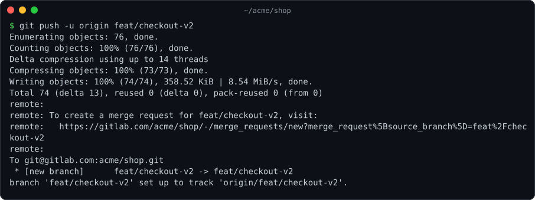
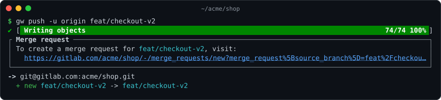
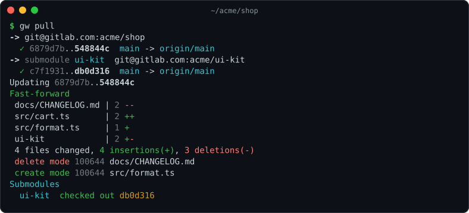
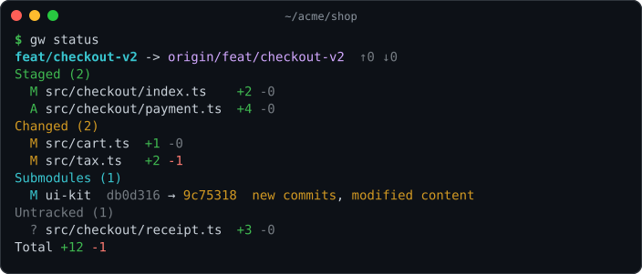
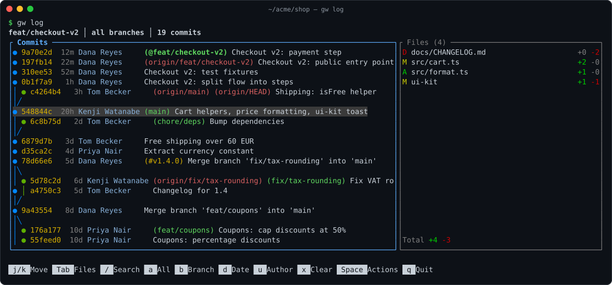
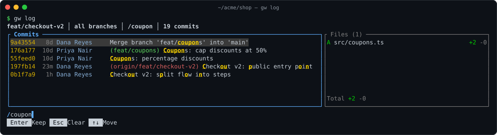
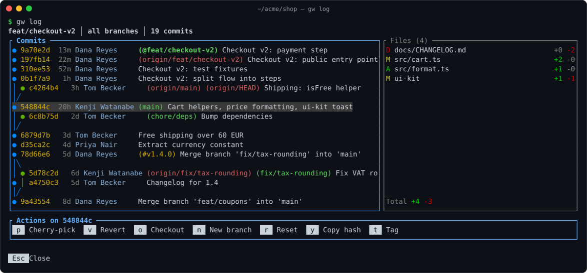
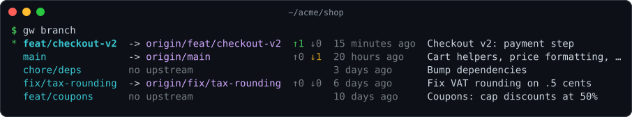
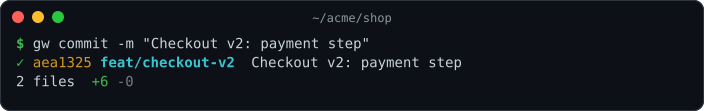
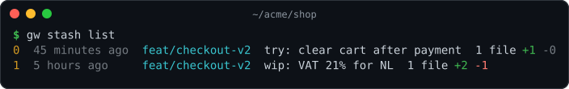

# gw

**git, but readable.** `gw` runs your usual git commands and turns their output into something you can take in at a glance: a live progress bar instead of scrolling counters, server messages in a box with clickable links, colored ref updates, a grouped `status` with per-file line counts, and a full-screen `log` browser.

It isn't a new VCS and it doesn't hide git from you. Arguments go to git unchanged, git's exit code comes back unchanged, and when the output isn't a terminal `gw` *is* plain git.

[](https://github.com/JiLiZART/gw/actions/workflows/ci.yml)
[](LICENSE)

```sh
cargo install git-gw --locked
```

## Before and after

The same push to GitLab. Plain git:



With gw:



The progress is one animated line (spinner, stage, `cur/total`, percent) that settles into a `✔` when the push succeeds. The `remote:` lines turn into a titled box (**Merge request**, **Pull request**, or **remote**) with the URL as a clickable link. The ref update is one colored line under the target.

## What you get

### `gw pull`: every line colored, submodules included



- **One header per repository.** A recursive fetch puts the superproject's updates and each submodule's updates (`-> submodule ui-kit`) under their own headers, never mixed together.
- **A colored summary.** `Updating old..new`, the fast-forward, merge, or rebase result, conflicts in red, diffstat bars, the insertions and deletions totals, and `create mode`/`delete mode` lines.
- **`gw merge` gets the same summary**: `Auto-merging` dimmed, conflicts and failed submodule merges in red, `error:`/`warning:` prefixes colored, and `hint:` lines dimmed.
- **A Submodules section.** It lists each checked-out submodule with its new commit, instead of git's `Submodule path '…': checked out '<40-char sha>'`.

### `gw status`: grouped, counted, no hints



- **The header** shows the branch, its upstream, and ahead/behind as `↑N ↓M`.
- **The groups** are Conflicts, Staged, Changed, Submodules, and Untracked. Each file gets GitHub-style `+N -M` counts, and a **Total** line sums them.
- **Submodules** show the recorded and checked-out commits (`db0d316 → 9c75318`) and what's going on inside: `staged`, `new commits`, `modified content`, `untracked content`.
- **No `(use "git add <file>..." …)` advice lines.**

### `gw log`: a commit browser in your terminal



- **The commit list** has the branch graph on the left, with refs and tags inline. The **changed files** of the selected commit are on the right with line counts. Press `Enter` on a file to see its diff.
- **The view starts on the current branch.** Press `a` for all branches, or `b` to pick one, `d` for a date range (`2 weeks ago`, `2026-10-01`), or `u` for an author.
- **Fuzzy search** with `/` matches hash, subject, author, and refs:



- **Actions on any commit** with `Space`: cherry-pick, revert, checkout, new branch, reset (soft / mixed / hard, always confirmed; a hard reset first lists the files you would lose), copy the hash, or create a tag:



### `gw branch`, `gw commit`, `gw stash list`







## Safe to drop in

- **Same arguments, same exit code.** `gw` passes your arguments to git untouched and exits with git's code (`128 + signal` if git was killed, 127 if git is missing).
- **Pipes and scripts get plain git.** When stdout is not a terminal (pipes, CI, `$(...)`), `gw` behaves exactly like `git`.
- **Machine formats pass through.** `gw status -s` / `--porcelain` / `-z`, `gw log --oneline` / `--format` / `-p` / `--graph`, `gw commit --dry-run`, `gw merge --edit` / `--continue` / `--abort`, `gw branch <anything>`, and every `gw stash` form except `list` run plain git.
- **Anything else is plain git.** `gw diff`, `gw rebase`, `gw show`, … just run git.
- **Untrusted text is inert.** Control characters in file names, branch names, and server messages are shown as `\xNN`, so a hostile remote or file name can't inject terminal escape sequences.
- **`NO_COLOR` is respected.** Colors turn off, the layout stays the same, the bar uses `#` and `.`, and links stay clickable.

## Install

```sh
cargo install git-gw --locked
```

The crate is `git-gw` (the name `gw` is taken on crates.io); the installed command is `gw`. You need Rust 1.88 or newer and `git` 2.41 or newer on `PATH`.

From source:

```sh
git clone https://github.com/JiLiZART/gw.git
cd gw
cargo install --path apps/gw --locked
```

If you installed an earlier build from source, remove it first, or cargo refuses because both provide `gw`:

```sh
cargo uninstall gw
```

## Usage

```sh
gw push [git push args...]
gw pull [git pull args...]
gw fetch [git fetch args...]
gw clone [git clone args...]
gw merge [git merge args...]
gw status [pathspec...]
gw log [revisions] [-- paths]
gw branch
gw commit [git commit args...]
gw stash list
```

### Use it from git

Add shell aliases so `gw` runs behind short git commands:

```sh
git config --global alias.p  '!gw push'
git config --global alias.pl '!gw pull'
git config --global alias.f  '!gw fetch'
git config --global alias.st '!gw status'
git config --global alias.l  '!gw log'
git config --global alias.br '!gw branch'
git config --global alias.ci '!gw commit'

git p origin feat    # runs: gw push origin feat
```

Alias names can't shadow built-in commands: git ignores an alias named `push`, `pull`, `status`, and so on.

### `gw log` keys

| Keys | Action |
|---|---|
| `j`/`k`, `↑`/`↓`, `PgUp`/`PgDn`, `g`/`G` | Move |
| `Tab` | Switch between commits and files |
| `Enter` (on a file) | Show its diff; `Esc` goes back |
| `/` or `Ctrl-F` | Fuzzy search by hash, subject, author, or ref; `Enter` keeps it, `Esc` clears it |
| `a` | Toggle current branch / all branches |
| `b` | Pick a branch |
| `d` | Date range (Since / Until, e.g. `2 weeks ago`, `2026-10-01`) |
| `u` | Pick an author, or type any author pattern |
| `x` | Clear all filters |
| `Space` | Actions on the selected commit |
| `q`, `Ctrl-C` | Quit |

Actions (`Space`, then a key): `p` cherry-pick, `v` revert, `o` checkout (detached), `n` new branch here, `r` reset (`s`oft / `m`ixed / `h`ard), `y` copy hash, `t` tag.
Cherry-pick, revert, checkout, and reset hand the terminal to git, so editors and conflict messages work; press Enter to come back.
Copying uses the terminal clipboard (OSC 52); in tmux this needs `set -g set-clipboard on`.

## How it's built

```
apps/gw          binary: dispatch, runs git, live progress line, gw log event loop
crates/gw-parse  pure parsers for git output, tested against captured fixtures
crates/gw-render progress bar, static ANSI views, and the gw log UI (ratatui)
```

`gw` never reimplements git. It runs git, asks for machine-readable output where git offers it (`--porcelain`, `-z`, `LC_ALL=C` for the network commands), parses the stream as it arrives, and renders. The parsers have no dependencies and are tested against output captured from real git runs.

The screenshots above are real `gw` output from a demo repository, rendered to SVG.

## License

MIT. See [LICENSE](LICENSE).
